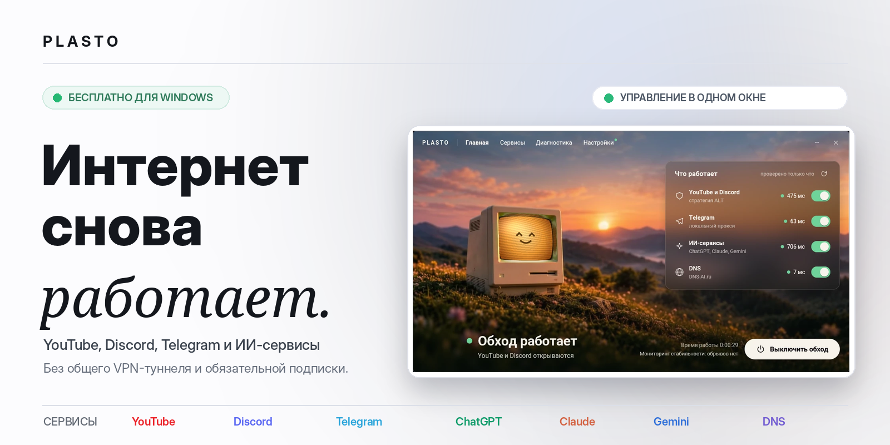
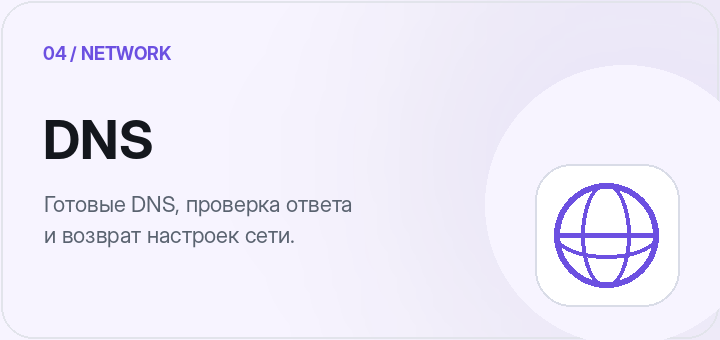
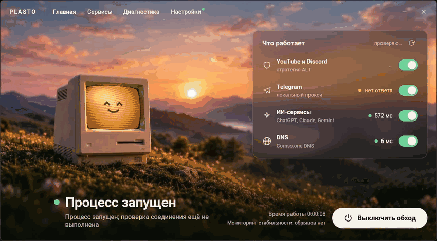
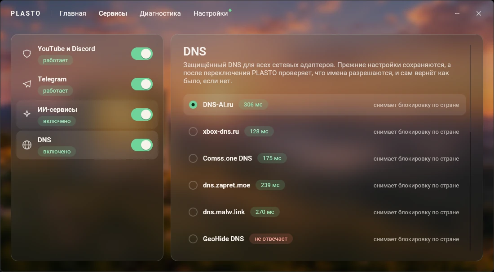
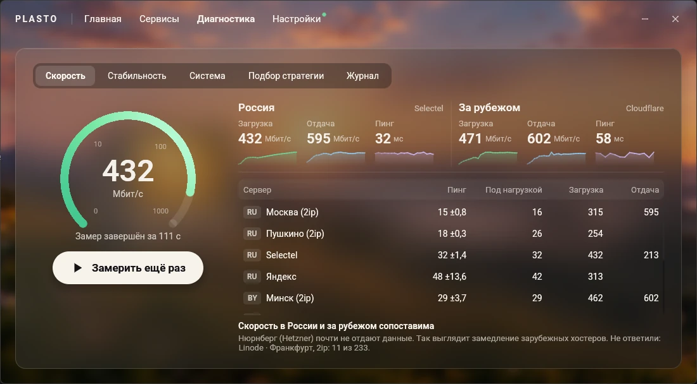
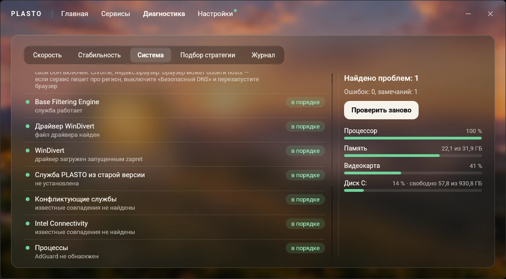
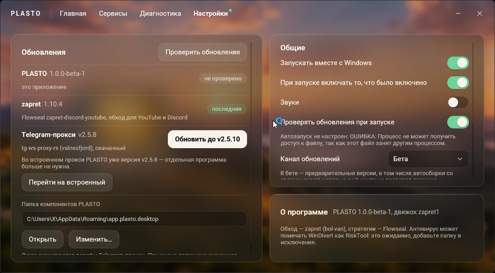
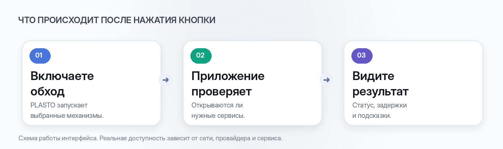
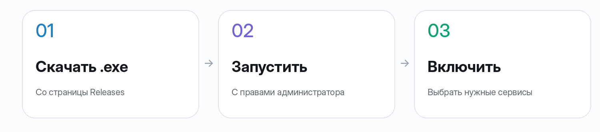

 

&nbsp;

**Windows 10/11 · x64 · Бесплатно · Один .exe-файл · Без обязательного VPN**

[Возможности](#возможности) · [Скриншоты](#интерфейс) · [Как работает](#как-это-работает) · [Скачать](#быстрый-старт) · [Частые вопросы](#частые-вопросы)

---

## Обход блокировок — не отдельная профессия

**PLASTO** — бесплатное приложение для Windows, которое помогает настроить доступ к нейросетям **Gemini, ChatGPT и Claude**, а также к **YouTube, Discord и Telegram**. Вместо нескольких отдельных инструментов — одно окно, одна главная кнопка и понятная проверка результата.

PLASTO объединяет **подбор стратегий DPI-обхода**, прокси для Telegram и ИИ-сервисов, выбор и проверку DNS, измерение скорости и задержки, мониторинг стабильности и системную диагностику. Приложение помогает определить вероятный участок сбоя — домашняя сеть, провайдер или внешнее соединение. Для локального DPI-обхода не требуется направлять весь интернет-трафик через единый VPN-сервер. Для некоторых сервисов приложение **использует прокси** — это отдельные механизмы, а не обещание полностью обходиться без них.

## Возможности

  
  
  
  

**И всё это управляется из одного интерфейса.** Можно включать функции раздельно или пользоваться главным переключателем, который запускает выбранные механизмы. PLASTO показывает не просто состояние запущенного процесса, а результат проверки доступности сервисов.

## Интерфейс

Никаких концептов и придуманных экранов — ниже **скриншоты настоящего PLASTO**.

### Один взгляд — и понятно, что происходит

  

Два состояния интерфейса: запуск и успешная проверка. Анимация составлена из скриншотов, а не является записью работы в реальном времени.

### Отдельное управление каждым сервисом

Выбирайте нужные сервисы, DNS-провайдеров и стратегии. Ненужные механизмы можно оставить выключенными.

### Диагностика — не просто тест скорости

  
  

Проверяйте загрузку, отдачу, пинг, задержку под нагрузкой и джиттер. Отдельная диагностика ищет конфликты драйверов, служб, VPN, настроек DNS и системы. Мониторинг стабильности отслеживает обрывы и помогает подготовить отчёт для провайдера.

### Настройки без ручного редактирования конфигов

Автозапуск, обновления, поведение при закрытии, папки компонентов и продвинутые параметры — там, где их можно найти.

## Как это работает

В основе — несколько разных способов восстановления доступа, а не «одна волшебная технология»:

- **DPI-обход** изменяет обработку соединений с поддерживаемыми сайтами через `zapret` и драйвер `WinDivert`. PLASTO предлагает подбор подходящей стратегии.
- **Telegram-прокси** работает как локальный компонент и подключается в Telegram по ссылке.
- **ИИ-сервисы** могут требовать двух отдельных действий: обхода ограничений провайдера и использования прокси для сервисов с региональными ограничениями.
- **DNS** позволяет выбрать альтернативный сервер, проверить его доступность и при необходимости вернуть системные настройки.

> [!IMPORTANT]
> PLASTO не гарантирует доступ ко всем сервисам в любой сети. Эффективность обхода, задержка и скорость зависят от провайдера, региона, выбранной стратегии и используемого прокси. Скриншоты демонстрируют интерфейс приложения, а не результаты измерений вашего подключения.

## Быстрый старт

1. **Скачайте** файл `PLASTO.exe` на странице [GitHub Releases](https://github.com/plastoorg/PLASTO/releases). Для запуска не нужен отдельный установщик.
2. **Запустите с правами администратора.** Они необходимы Windows для загрузки драйвера WinDivert, через который работает DPI-обход.
3. **Включите обход.** При первом запуске PLASTO предложит подобрать рабочую стратегию. Вы можете оставить только нужные сервисы.

Базовые компоненты `zapret` включены в сборку — для их первоначального получения необязательно скачивать отдельный архив с GitHub.

**Требования:** Windows 10 или 11 (x64). Часть возможностей защищённого DNS доступна только в Windows 11.

## Подробности для тех, кто любит контроль

<b>Обход блокировок: стратегии, домены и игры</b>

- Автоматический подбор стратегии по результатам проверок YouTube, Discord и других адресов; повторный подбор при проблемах.
- Ручной выбор и тестирование стратегии.
- Встроенная сборка `zapret-discord-youtube`; возможность обновления компонентов.
- Игровой фильтр с обработкой соответствующих портов и настройками для онлайн-игр.
- Добавление собственных доменов.
- Для опытных пользователей — выбор движка и просмотр/изменение команды запуска.

<b>Telegram и ИИ: встроенные прокси и адресные настройки</b>

**Telegram:** встроенный `tg-ws-proxy-rs`, подключение по ссылке, копирование прокси, возможность переключения на другую поддерживаемую реализацию.

**ИИ-сервисы:** ChatGPT, OpenAI API и Codex, Claude, Gemini, AI Studio, Google Labs, Grok, GitHub Copilot, Cursor, JetBrains AI, Perplexity, Hugging Face и другие. Доступность зависит от текущих ограничений каждого сервиса.

- Раздельные настройки обхода блокировки провайдера и регионального прокси.
- Проверка доступа к сервисам, обновление каталога прокси и возможность задать свой SNI-прокси.
- [Как настроить доступ к Gemini, ChatGPT и Claude](https://plastoorg.github.io/PLASTO/ai-services.html): обход, прокси, проверка и восстановление настроек.
- Дополнительный блоклист вредоносных и рекламных адресов.
- Резервная копия `hosts` с возможностью восстановления исходного состояния.

<b>DNS: выбор сервера, проверка и восстановление</b>

- Готовые профили: DNS-AI.ru, xbox-dns.ru, Comss.one, dns.zapret.moe, dns.malw.link, GeoHide, CommonNet, Bezmezhau, а также Cloudflare и Google.
- Проверка времени ответа и доступности DNS.
- Добавление собственных DNS-адресов.
- Проверка выбранного DNS с возможностью автоматического переключения при отказе.
- Восстановление прежних DNS-настроек сети одной командой.

<b>Диагностика: скорость, стабильность и система</b>

- Тестирование загрузки, отдачи, пинга, джиттера и задержки под нагрузкой на российских и зарубежных серверах.
- Контроль соединения с интервалом около секунды, включая работу в трее.
- Анализ вероятного участка сбоя: Wi-Fi/кабель, маршрутизатор, провайдер или внешняя сеть.
- История обрывов и графики за разные периоды.
- Экспорт HTML-отчёта с временными отметками для обращения к провайдеру.
- Проверки системного прокси, защищённого DNS, файла `hosts`, драйвера WinDivert и конфликтующих программ.
- Сводка по процессору, памяти, видеокарте и накопителю.
- Просмотр журнала событий обхода.

<b>Настройки, обновления и автозапуск</b>

- Запуск вместе с Windows, сохранение набора включённых сервисов, работа в трее.
- Настройка звуков, поведения при закрытии и отображения окна поверх других.
- Обновление приложения, `zapret` и Telegram-прокси из интерфейса.
- Стабильный и бета-каналы обновлений; бета-сборки могут быть предварительными и не проходить ручную проверку.
- Выбор папки для компонентов с переносом уже скачанных файлов.

> [!WARNING]
> Получено сообщение об обнаружении Microsoft Defender `Behavior:Win32/Persistence.A!ml` при запуске PLASTO. Файл отправлен в Microsoft на проверку; её результат пока не подтверждён. Не отключайте защиту и не восстанавливайте файл из карантина автоматически. [Информация и шаги проверки](https://plastoorg.github.io/PLASTO/help.html#antivirus).

## Антивирусы и WinDivert

Для DPI-обхода PLASTO использует компоненты zapret и WinDivert — инструмент перехвата и фильтрации сетевых пакетов. WinDivert применяется как легитимными программами, так и вредоносным ПО, поэтому антивирус может классифицировать его как RiskTool, PUA или инструмент повышенного риска и поместить файл в карантин. Название обнаружения зависит от продукта и само по себе не подтверждает ни наличие вируса, ни безопасность конкретной сборки.

Если PLASTO перестал работать после обнаружения, проверьте название и путь файла в журнале защиты, скачайте релиз из официального репозитория и сверьте SHA-256 с указанным в релизе. При сомнениях обратитесь к разработчику антивируса. Если вы проверили файл и доверяете ему, можно настроить узкое исключение для конкретного файла или папки компонентов PLASTO согласно инструкции вашего антивируса. Исключение снижает защиту для указанного объекта; не отключайте антивирус или защиту от потенциально нежелательных программ целиком.

Подробнее о WinDivert: [раздел «Антивирусы» в zapret-win-bundle](https://github.com/bol-van/zapret-win-bundle/blob/master/readme.md#антивирусы).

## Помощь с запуском и подключением

Если PLASTO не запускается, сервисы не открываются или антивирус поместил компонент в карантин, воспользуйтесь [инструкцией по диагностике](docs/diagnostika.md).

## Частые вопросы

<b>Это VPN?</b>

Нет, PLASTO не создаёт обязательный общий VPN-туннель для всего трафика. Локальный DPI-обход выполняется на компьютере. Однако отдельные функции — в частности, доступ к Telegram и регионально ограниченным ИИ-сервисам — могут использовать прокси.

<b>Почему нужны права администратора?</b>

Windows требует повышенные права для операций с сетевым драйвером `WinDivert`. Без них механизм DPI-обхода не сможет запуститься.

<b>Почему антивирус предупреждает о WinDivert?</b>

WinDivert — инструмент перехвата сетевых пакетов, который может определяться защитным ПО как `RiskTool`. Само по себе такое название детекта не доказывает, что файл вредоносный, но и не гарантирует безопасность любой сборки. Скачивайте PLASTO из доверенного источника и проверяйте файлы; исключения в антивирусе добавляйте только после проверки.

<b>Можно использовать с другими VPN и zapret?</b>

Одновременный запуск другого `zapret` или VPN в режиме TUN может приводить к конфликтам обработки трафика. Рекомендуется сначала остановить конфликтующий инструмент и выполнить системную диагностику PLASTO.

<b>Как полностью удалить PLASTO?</b>

1. Выключите обход.
2. Если меняли `hosts` или DNS, восстановите исходные параметры через соответствующие разделы приложения.
3. Отключите автозапуск в настройках.
4. Завершите PLASTO через значок в трее, удалите исполняемый файл и папку `%AppData%\app.plasto.desktop` (или выбранную вручную папку компонентов).

## Открытые технологии и благодарности

PLASTO объединяет существующие технологии и инструменты. Благодарность авторам и сопровождающим проектам:

- [zapret](https://github.com/bol-van/zapret) — bol-van, движок DPI-обхода.
- [zapret-discord-youtube](https://github.com/Flowseal/zapret-discord-youtube) — Flowseal, готовые стратегии и сборка.
- [tg-ws-proxy](https://github.com/Flowseal/tg-ws-proxy) и [tg-ws-proxy-rs](https://github.com/valnesfjord/tg-ws-proxy-rs) — инструменты Telegram-прокси.
- [dns.malw.link](https://dns.malw.link) — каталог настроек прокси для ИИ-сервисов.
- Авторам DNS-проектов, доступных в настройках приложения.

В этом репозитории размещены исходный код приложения, инструкция по сборке и готовые сборки в Releases. Сайт проекта находится в [отдельном репозитории](https://github.com/PLASTO-ORG/PLASTO-site).

**Проект и релизы:** [репозиторий PLASTO](https://github.com/plastoorg/PLASTO) · [Скачать PLASTO.exe](https://github.com/plastoorg/PLASTO/releases/latest/download/PLASTO.exe) · [Сообщить о проблеме](https://github.com/plastoorg/PLASTO/issues).

---

### Интернет должен работать.

PLASTO · Бесплатное приложение для Windows · DPI-обход, Telegram-прокси, DNS и диагностика сети

  

  

Страница проекта: <a href="https://plastoorg.github.io/PLASTO/">GitHub Pages</a> · Дизайн и изображения README находятся в <code>docs/assets/readme/</code>

